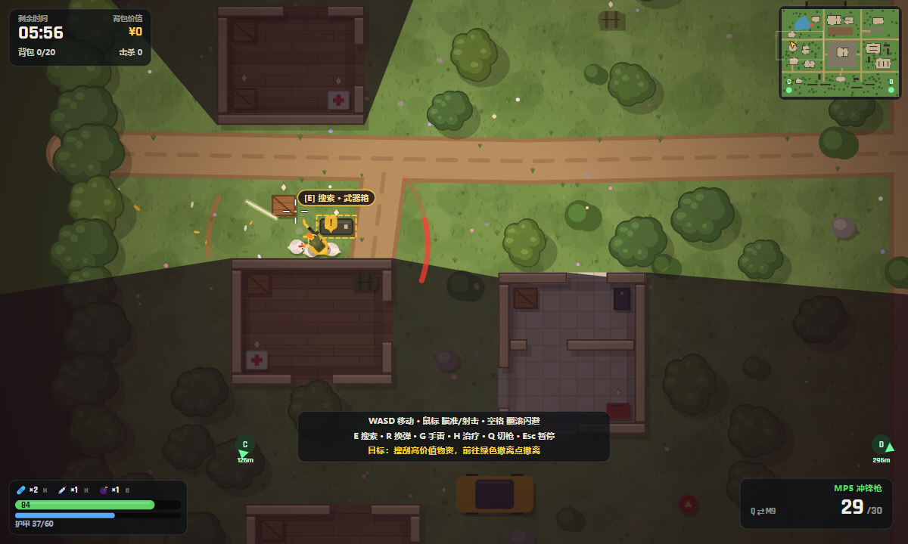

# 鸭鸭鸭行动

一款俯视角单人撤离射击游戏。搜箱、交火，赶在倒计时结束前把物资带出鸭鸭岛。

**[在线试玩](https://yyyaction.solidsunbird5.chatgpt.site)** · 使用站点所有者的 ChatGPT 账号访问



## 怎么玩

第一次可以从免费新手行动开始。靠近木箱搜出电池，击败一只小鸡，再在绿色撤离区停留 6 秒。正式行动限时 6 分钟，撤离成功才能把搜到的物资带回仓库。仓库和排行榜保存在当前浏览器中。

| 操作 | 键鼠 | 触屏 |
| --- | --- | --- |
| 移动 | WASD | 拖动左半屏 |
| 瞄准射击 | 移动鼠标并按左键 | 拖动右半屏，自动开火 |
| 搜索 | 靠近箱子后按 E | 靠近箱子后点「搜索」 |
| 翻滚 | 空格或鼠标右键 | 点右下角「翻滚」 |

## 角色

在大厅选择角色，再选出击装备。角色可免费切换，选择会随存档保留。卡片的护甲值随所选装备变化。

| 角色 | 基础移速 | 护甲规则 |
| --- | --- | --- |
| 小黄 | 100% | 使用装备原有的护甲数值，最低 25 点 |
| 铁头（Tank） | 80% | 护甲额外增加 45 点 |
| 快羽（Scout） | 120% | 护甲为装备数值的 55%，四舍五入，最低 15 点 |

护甲规则同样用于局内换上的护甲。三位角色都能参加新手行动，试一试各自的移速和护甲。

## 仓库与枪械改造

网页版在大厅点「仓库」管理带回来的枪械和护甲。局内找到的枪械和护甲先进入背包，成功撤离后按件入库，其余带出的物资折现。仓库也出售枪械，拥有的枪可以付费做一次稳定改造，让游戏内射击散布减少 20%。

配装时可选一把枪和一件护甲。仓库配装出击没有额外装备费，带入的库存暂扣一件，成功撤离后原样归还，失败或放弃则丢失。库存不足时可以重新配装或免费跑刀。

## 战区与首领

在大厅的「选择战区」查看地图缩略图和首领头像。绿色标记候选撤离点，橙色标记首领驻地（双首领地图会标出两处）。解锁使用本地存档中的正式撤离次数，已有记录会计入，新手行动单独结算。每张正式地图限时 6 分钟，有两个撤离点可用，击败首领是可选目标。战区按解锁顺序难度递增：入门 → 普通 → 困难 → 精英 → 噩梦 → 地狱。

| 战区 | 入口 | 场景与敌人 | 可带出物资 |
| --- | --- | --- | --- |
| 鸭鸭岛 | 默认开放 | 湖畔、农场、军事基地与铁路货场。鹅老大镇守基地。 | 民用补给、军械、保险箱和首领物资 |
| 盐雾货港 | 正式撤离 1 次 | 绕过水道，穿行北岸装卸通道或南侧货棚。小鸡在通道巡游，护甲鸭守中央装卸场，哨戒鸭守外港。 | 码头补给、武器箱和保险箱。首领必掉传说级船长航海日志（¥96,000）及一件随机史诗物资。 |
| 赤炉工厂 | 正式撤离 3 次 | 外门进入分拣车间，通往炉前广场、控制室和铁路装运口。护甲鸭守车间与控制室，精英守广场，哨戒鸭守装运口。 | 控制室机箱、保险箱和军械。首领必掉至臻级封存炉芯（¥260,000）及一件随机传说物资。 |
| 腐叶孵化场 | 正式撤离 5 次 | 沼泽水洼把育雏棚、孵化控制室与东侧巢室切割成数条通道。鸭后镇守中央巢穴，成群小鸡和投弹母鸡从四面涌来。 | 巢穴补给、冰风 MP9、RPG。首领必掉传说级鸭后金蛋（¥180,000）及一件随机史诗物资。 |
| 霜锋哨站 | 正式撤离 8 次 | 冰封机库、雷达站与冻土广场。霜羽元帅守西侧冰湖，铁壁统领守东侧广场，两名首领同时参战。 | 两处军械库，固定刷新龙纹 AWM、渐变之影 M4A1 与 RPG。 |
| 鸭王陵寝 | 正式撤离 12 次 | 神道通往双宝库与王座大厅，禁卫鸭、护盾鸭和投弹母鸡层层设防。鸭王在大厅中央轮换四种招式。 | 双宝库至臻物资、火神炮、冰风 MP9。首领必掉至臻级鸭王御座（¥880,000）及一件随机传说物资。 |

**护甲鸭**穿重甲、移速慢，靠近后用霰弹枪压制。**哨戒鸭**没有护甲，发现玩家的距离更远，会拉开距离用步枪短点射。两种敌人也会在鸭鸭岛的军事基地、谷仓附近或铁路货场出现。

- **铁钩船长 · 中等难度。** 每局驻守盐雾货港中央装卸场，发现玩家或受击后接战。持霰弹枪，冲撞前会锁定方向并画出红线。横向闪避可让开冲撞，船长撞上货柜或墙体会短暂眩晕。生命降至 50% 时，冲撞预警缩短、距离和伤害增加，冷却缩短。
- **炉心监工 · 高难度。** 每局驻守赤炉工厂炉前广场，发现玩家或受击后接战。持突击步枪，近身会先画出橙圈再释放热浪。离开橙圈、用实墙阻断视线或在释放时翻滚都能避开热浪。生命降至 45% 时，热浪范围和伤害增加，预警和冷却缩短。
- **孵巢鸭后 · 精英难度。** 腐叶孵化场的召唤型首领。每隔一段时间在巢穴画出绿色虚线圈并孵出一波小鸡、母鸡和鸭匪；第二阶段孵化更快、数量更多，还会混入精英。优先清掉杂兵，再集中火力打首领；同行数量有上限，不会无限堆积。
- **霜羽元帅 + 铁壁统领 · 噩梦难度（双首领）。** 霜羽元帅持冰风 MP9，命中会减速，寒潮为冰蓝圈；铁壁统领正面装甲极厚，需要绕后输出，红色预警线代表它的冲撞。两名首领共用顶部血条区，击败其中一名后另一位仍在场。
- **鸭王 · 地狱难度。** 鸭王陵寝的最终首领，按「震地 → 孵巢 → 冲撞 → 王权冲击」顺序轮换四种招式，每种预警形状不同。45% 血量后全面提速并召唤更多护卫。注意顶部血条旁的技能名提示，再决定是翻滚、退圈还是绕后。

首领奖励通过搜刮遗体取得，随背包成功撤离后计入仓库。战区布局和入口条件在 `src/game/map.ts`，首领数值、阶段和掉落配置在 `src/game/data.ts`。货柜、地板、水面、轨道和首领造型复用游戏内置的 Canvas 资源。

## 本地运行（维护者及获授权的开发者）

```bash
npm ci
npm run dev
```

打开终端显示的本地地址即可。`npm run build` 会生成可部署到静态托管的 `dist/index.html`。

## 源码授权

© 2026 momoheal，保留所有权利。仓库公开供查阅。除适用法律或平台条款允许的情形外，复制、修改、分发、另行部署或商用本项目原创内容，需事先取得权利人的书面授权。GitHub 站内查看和 Fork 适用 GitHub 服务条款，第三方依赖适用各自的许可证。详见 [LICENSE](LICENSE)。
